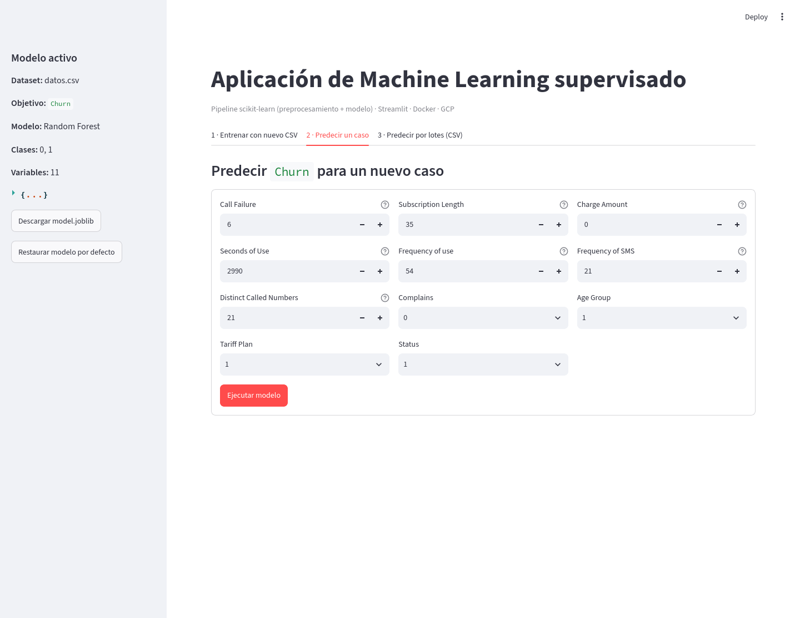
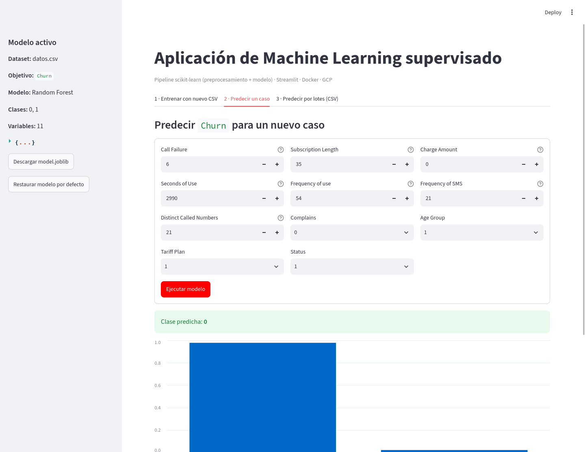

# Despliegue de Modelos de Machine Learning: Pipeline Supervisado, Contenedorización con Docker y Servicio en Google Cloud Platform

**Asignatura:** Machine Learning II  
**Programa:** Pregrado en Ciencia de Datos  
**Modalidad:** Reto Práctico de Ciclo de Vida Completo de Machine Learning  

---

## 1. Descripción y Propósito del Proyecto

En este proyecto implementamos el ciclo de vida completo de una solución de Machine Learning aplicada: desde la ingesta de datos y el preprocesamiento automatizado hasta el entrenamiento, la evaluación estadística, la serialización de artefactos, el desarrollo de la interfaz interactiva, la contenedorización con Docker y el despliegue en una máquina virtual de infraestructura como servicio (IaaS) en Google Cloud Platform (Compute Engine).

Nuestro objetivo principal es garantizar la reproducibilidad estricta del sistema en entornos heterogéneos (Google Colab, entornos locales basados en contenedores y servidores de producción en la nube), asegurar la paridad numérica en inferencia y desacoplar la fase de entrenamiento de la fase de servicio.

---

## 2. Conjunto de Datos y Unidad de Observación

- **Fuente:** Repositorio académico oficial del curso ([`Customer_Churn_Iran.csv`](https://raw.githubusercontent.com/wilmerpineda/machine_learning_ii_course_public/main/datasets/public/Customer_Churn_Iran.csv)).
- **Unidad de Análisis:** Cada registro corresponde a un cliente individual de una empresa de telecomunicaciones, evaluado a lo largo de un período de observación de 12 meses.
- **Volumen:** 3.150 observaciones y 14 columnas tabulares sin presencia de valores nulos estructurales.
- **Variable Objetivo (`Target`):** `Churn` (variable binaria, donde `1` representa el abandono del servicio por parte del usuario y `0` representa la retención).
- **Distribución de Clases:** Trabajamos con un problema de clases desbalanceadas (aproximadamente 15,7% de casos positivos y 84,3% de casos negativos), lo que nos exige una estrategia de evaluación especializada.

---

## 3. Ruta Metodológica

Desarrollamos el proyecto bajo la **Ruta A (Aprendizaje Supervisado - Clasificación Binaria)** definida en la guía de laboratorio:

- Modelamiento predictivo supervisado con partición estratificada de datos (80% entrenamiento, 20% prueba, `random_state=42`).
- Arquitectura basada en `Pipeline` de `scikit-learn` que integra de forma atómica la imputación, estandarización, codificación categórica y estimador.
- Serialización de artefactos con metadatos completos y caso de referencia para comprobación de paridad numérica.

---

## 4. Definición y Justificación de Variables

A fin de evitar fuga de información (*data leakage*) y asegurar que la interfaz de usuario reciba únicamente información disponible al momento de la toma de decisiones, aplicamos el siguiente esquema de variables. La variable objetivo es `Churn` (1 = abandono, 0 = permanencia), con un desbalance aproximado de 15,7 % positivos / 84,3 % negativos; por eso la partición es estratificada y la evaluación prioriza la clase positiva.

### 4.1 Variables Predictoras Incluidas

| Variable | Tipo | Por qué se incluye | Tratamiento en el pipeline |
|:---|:---|:---|:---|
| `Call Failure` | Numérica discreta (conteo) | Frecuencia de llamadas fallidas; mide problemas de red o insatisfacción y es una señal temprana de abandono. | Mediana + estandarización |
| `Subscription Length` | Numérica (meses) | Antigüedad del cliente; distingue clientes nuevos de clientes con relación establecida. | Mediana + estandarización |
| `Charge Amount` | Numérica discreta (nivel tarifario) | Nivel de cobro o plan; aproxima el valor económico del cliente. | Mediana + estandarización |
| `Seconds of Use` | Numérica continua (segundos) | Intensidad de consumo; un mayor uso sugiere dependencia del servicio. | Mediana + estandarización |
| `Frequency of use` | Numérica discreta (conteo) | Número de llamadas efectuadas; intensidad de la relación con la operadora. | Mediana + estandarización |
| `Frequency of SMS` | Numérica discreta (conteo) | Uso de mensajes de texto; nivel de *engagement* del cliente. | Mediana + estandarización |
| `Distinct Called Numbers` | Numérica discreta (conteo) | Diversidad de contactos; tamaño de la red social del cliente. | Mediana + estandarización |
| `Complains` | Categórica binaria (0/1) | Presencia de queja formal; predictor directo de insatisfacción y churn. | Moda + one-hot |
| `Age Group` | Categórica ordinal (1–5) | Segmento etario; captura heterogeneidad demográfica en la propensión al abandono. | Moda + one-hot (no se impone orden) |
| `Tariff Plan` | Categórica nominal (1 = Contractual, 2 = Prepago) | Tipo de plan; el prepago suele asociarse a mayor rotación. | Moda + one-hot |
| `Status` | Categórica nominal (1, 2) | Estado operativo de la línea; puede reflejar actividad o suspensión del servicio. | Moda + one-hot |

### 4.2 Variables Excluidas

| Variable | Motivo de exclusión |
|:---|:---|
| `Customer Value` | Se calcula *a posteriori* a partir de métricas agregadas de uso. Incluirla generaría fuga de información y no está disponible para un cliente nuevo o en una intervención temprana. |
| `Age` | Presenta una correspondencia **1:1** con `Age Group` (15→1, 25→2, 30→3, 45→4, 55→5). Mantener ambas duplicaría exactamente las mismas columnas one-hot sin aportar información; conservamos `Age Group`, que es el agrupamiento interpretable. |
| `Churn` | Es la variable objetivo; no entra como predictor. |

> No incluimos identificadores porque el dataset no los contiene. Si existieran columnas como `ID` o `Customer ID`, las excluiríamos para evitar que el modelo memorice clientes en lugar de aprender patrones.

---

## 5. Preparación de Datos y Arquitectura del Pipeline

Para asegurar que las mismas transformaciones del entrenamiento se repliquen exactamente durante la inferencia, utilizamos un `ColumnTransformer` encapsulado en un `Pipeline`:

```
Entrada tabular (CSV o Formulario)
       │
       ├── Columnas Numéricas ──────> SimpleImputer(median) ─────────> StandardScaler() ───┐
       │                                                                                   │
       └── Columnas Categóricas ────> SimpleImputer(most_frequent) ──> OneHotEncoder() ────┤
                                                                                           │
                                                                   Concatena matriz de features
                                                                                           │
                                                                                           ▼
                                                                             Estimador (Clasificador)
```

- **Manejo de categorías no observadas:** El codificador `OneHotEncoder` utiliza el parámetro `handle_unknown="ignore"`, asignando un vector nulo a categorías no presentes en la fase de entrenamiento, evitando fallas críticas en tiempo de ejecución.
- **Normalización de identificadores de columna:** Procesamos los encabezados para eliminar codificaciones BOM y duplicidad de espacios tipográficos presentes en el archivo fuente.

---

## 6. Selección y Evaluación del Modelo

Realizamos una comparativa empírica entre el modelo base propuesto en la guía (`LogisticRegression`) y un ensamble de árboles (`RandomForestClassifier`, configurado con 300 estimadores, `min_samples_leaf=5`, `class_weight="balanced"` y `random_state=42`).

### 6.1 Selección con Validación Cruzada (5-fold estratificada)

Para evitar el sesgo de elegir "el mejor" modelo sobre el propio conjunto de prueba, hicimos la selección con **validación cruzada estratificada de 5 folds** sobre los datos de entrenamiento, reportando la clase positiva (`Churn=1`):

| Métrica (media ± desv., CV) | Regresión Logística (Base) | Random Forest (Seleccionado) |
|:---|:---:|:---:|
| **F1 (Clase Churn = 1)** | 0.5672 ± 0.0217 | **0.8406 ± 0.0226** |
| **Recall (Clase Churn = 1)** | 0.4404 ± 0.0290 | **0.9414 ± 0.0234** |
| **ROC-AUC** | 0.9354 ± 0.0071 | **0.9824 ± 0.0046** |

El **Random Forest** dominó consistentemente las tres métricas, por lo que lo seleccionamos. Reservamos el conjunto de prueba exclusivamente para la evaluación final (sección 6.2), sin usarlo en la selección.

### 6.2 Matriz de Confusión (Random Forest en Conjunto de Prueba, N = 630)

| Condición Real \ Predicción | Predicho Negativo (0) | Predicho Positivo (1) | Total Real |
|:---|:---:|:---:|:---:|
| **Real Negativo (0)** | 505 | 26 | 531 |
| **Real Positivo (1)** | 4 | 95 | 99 |

### 6.3 Métricas Cuantitativas Comparativas (Conjunto de Prueba)

| Métrica | Regresión Logística (Base) | Random Forest (Seleccionado) |
|:---|:---:|:---:|
| **Accuracy Global** | 0.8968 | **0.9524** |
| **Balanced Accuracy** | 0.7046 | **0.9553** |
| **Recall (Clase Churn = 1)** | 0.4242 | **0.9596** |
| **Precision (Clase Churn = 1)** | 0.8400 | **0.7851** |
| **F1 (Clase Churn = 1)** | 0.5638 | **0.8636** |
| **F1-Score Ponderado** | 0.8821 | **0.9543** |
| **ROC-AUC** | 0.9252 | **0.9844** |
| **Precision-Recall (Average Precision)** | 0.7616 | **0.9353** |

### 6.4 Justificación Técnica de la Elección
Debido a la asimetría en los costos de error asociados al problema de negocio, no identificar a un cliente que efectivamente abandonará el servicio (falso negativo) conlleva la pérdida del valor de vida del cliente (*lifetime value*), mientras que un falso positivo implica únicamente una acción preventiva de contacto. Por consiguiente, seleccionamos el modelo **Random Forest** por su capacidad de captura (**Recall de 95,96%** frente a 42,42% del modelo lineal) y su **F1 de la clase positiva (0.8636 frente a 0.5638)**. Reportamos el F1 de la clase positiva (no solo el ponderado, dominado por la clase mayoritaria) junto con la precisión-recall (*Average Precision*) para reflejar el desempeño sobre la clase de interés.

---

## 7. Estructura del Repositorio

Mantenemos una organización modular y desacoplada:

```
├── .streamlit/
│   └── config.toml          # Parámetros del servidor Streamlit (headless, maxUploadSize)
├── data/
│   └── datos.csv            # Copia local del dataset Customer_Churn_Iran.csv
├── pdf/
│   └── guia_completa_ml_streamlit_docker_gcp_colab.pdf # Guía académica del taller
├── src/
│   └── build_notebook.py    # Generador automatizado del cuaderno unificado
├── .dockerignore            # Reglas de exclusión para el contexto de Docker
├── .gitignore               # Reglas de exclusión para Git
├── app.py                   # Aplicación interactiva de servicio Streamlit
├── Dockerfile               # Instrucciones de construcción de la imagen de producción
├── ML_Supervisado_Streamlit_Docker_GCP.ipynb # Cuaderno ejecutable en Google Colab
├── ml_core.py               # Módulo central: inferencia de tipos, pipelines, métricas y CV
├── model.joblib             # Artefacto serializado (modelo entrenado + metadatos)
├── README.md                # Documentación técnica institucional
├── requirements.txt         # Dependencias con versiones fijadas (reproducibilidad)
└── train.py                 # Script de entrenamiento por línea de comandos
```

---

## 8. Instrucciones de Reproducción y Ejecución

### 8.1 Ejecución Completa desde Google Colab
1. Cargar el archivo `ML_Supervisado_Streamlit_Docker_GCP.ipynb` en Google Colab.
2. Ejecutar la secuencia a través del comando `Entorno de ejecución` -> `Ejecutar todo`.
3. El cuaderno genera de manera autónoma los scripts modulares, el artefacto entrenado, las pruebas de paridad y descarga el paquete `ml_streamlit_project.zip`.

### 8.2 Ejecución Local en Entorno Virtual

```bash
# 1. Creación e inicialización del entorno virtual
python3 -m venv .venv
source .venv/bin/activate

# 2. Instalación de dependencias del proyecto
pip install --upgrade pip
pip install -r requirements.txt

# 3. Ejecución del script de entrenamiento (reconstrucción de model.joblib)
python train.py

# 4. Despliegue local de la aplicación interactiva
streamlit run app.py --server.port=8501 --server.address=0.0.0.0
```

Acceder a través del navegador web a `http://localhost:8501`.

> **Nota sobre la pestaña de entrenamiento.** La aplicación no reentrena el modelo al arrancar: siempre sirve `model.joblib`. Incluye, como **extensión opcional**, una pestaña para entrenar con un CSV nuevo (solo si el usuario lo sube y pulsa "Entrenar"). Para no agotar la memoria de la VM, el número de filas está limitado por defecto a 20.000.

### 8.3 Captura de la Aplicación en Ejecución





Las capturas corresponden al contenedor `ml-streamlit` corriendo en `http://localhost:8501`. La predicción de ejemplo devolvió la clase `0` y las probabilidades que se ven en la gráfica. La pestaña de entrenamiento está en [`docs/evidencias/streamlit-entrenamiento.png`](docs/evidencias/streamlit-entrenamiento.png).

---

## 9. Empaquetamiento y Contenedorización con Docker

Empaquetamos el sistema en una imagen ligera basada en `python:3.12-slim`. La aplicación no requiere privilegios elevados y expone el puerto estándar `8501`.

### 9.1 Construcción de la Imagen Docker

```bash
docker build -t ml-streamlit-app .
```

### 9.2 Ejecución y Verificación del Contenedor

```bash
# Ejecución interactiva para verificación de logs de arranque
docker run --rm -p 8501:8501 ml-streamlit-app

# Ejecución en segundo plano con política de reinicio automático
docker run -d \
  --name ml-streamlit \
  --restart unless-stopped \
  -p 8501:8501 \
  ml-streamlit-app

# Inspección de estado y diagnóstico
docker ps
docker logs ml-streamlit
```

### 9.3 Evidencia de Construcción y Ejecución (verificada)

Registramos la evidencia el **2026-11-10** en un entorno Linux/WSL con Docker 29.1.3:

| Verificación | Resultado |
|:---|:---|
| `docker build -t ml-streamlit-app .` | `Successfully tagged ml-streamlit-app:latest` |
| `docker images ml-streamlit-app` | Imagen creada (≈245 MB de contenido) |
| `docker ps --filter name=ml-streamlit` | `Up (healthy)`, puerto `0.0.0.0:8501->8501/tcp` |
| `curl http://127.0.0.1:8501/_stcore/health` | `ok` |
| Carga del artefacto dentro del contenedor | `sklearn_version_artifact: 1.9.1`, sin `InconsistentVersionWarning` |
| Paridad numérica del caso de referencia | `parity_diff: 0.0` |
| Predicción de ejemplo dentro del contenedor | Clase `0`, `P(Y=0)=0.5093`, `P(Y=1)=0.4907` |

Guardamos los logs completos en:

- [`docs/evidencias/docker-build.log`](docs/evidencias/docker-build.log)
- [`docs/evidencias/docker-images.log`](docs/evidencias/docker-images.log)
- [`docs/evidencias/docker-run.log`](docs/evidencias/docker-run.log) (incluye `docker ps`, `docker logs` y healthcheck)
- [`docs/evidencias/docker-model-check.log`](docs/evidencias/docker-model-check.log)

Para reproducir la verificación:

```bash
docker build -t ml-streamlit-app .
docker run -d --name ml-streamlit --restart unless-stopped -p 8501:8501 ml-streamlit-app
sleep 10
docker ps
docker logs ml-streamlit
curl http://127.0.0.1:8501/_stcore/health
```

### 9.4 Evidencia de Entrenamiento y Prueba Funcional dentro del Contenedor

Ejecutamos el entrenamiento completo dentro de la imagen con `docker run --rm ml-streamlit-app python train.py`. El script regeneró `model.joblib` con las versiones fijadas, calculó la validación cruzada y verificó la paridad al recargar:

| Verificación | Resultado |
|:---|:---|
| Entrenamiento dentro de la imagen | `Modelo guardado en model.joblib` |
| Validación cruzada (5-fold) | Random Forest: F1 clase 1 `0.8406`, Recall `0.9414`, ROC-AUC `0.9824` |
| Métricas en test | Accuracy `0.9524`, F1 clase 1 `0.8636`, ROC-AUC `0.9844` |
| Paridad tras recargar | verificada por el `assert` de `train.py` |
| Prueba funcional de Streamlit (`AppTest`) | sin excepciones; 7 entradas numéricas, 4 selectores y `Clase predicha: 0` |

Logs:

- [`docs/evidencias/train-in-container.log`](docs/evidencias/train-in-container.log)
- [`docs/evidencias/streamlit-apptest.log`](docs/evidencias/streamlit-apptest.log)

---

## 10. Despliegue en Google Cloud Platform (Compute Engine)

A continuación detallamos el protocolo para desplegar la aplicación en una instancia virtual de Google Cloud:

### 10.1 Creación de la Instancia Virtual
1. Acceder a la consola de administración de Google Cloud Platform (`console.cloud.google.com`).
2. Navegar a **Compute Engine** -> **Instancias de VM**.
3. Seleccionar **Crear instancia** con las siguientes especificaciones:
   - **Sistema operativo:** Ubuntu 24.04 LTS (x86/64).
   - **Tipo de máquina:** `e2-small` o `e2-medium` (recomendado para estabilidad de memoria).
   - **IP Externa:** Asignación efímera o estática habilitada.
   - **Etiqueta de red:** `streamlit-server`.

### 10.2 Configuración del Cortafuegos (Firewall)
Para permitir el tráfico entrante al puerto 8501, ejecutar en Google Cloud Shell o crear la regla vía interfaz de red VPC:

```bash
gcloud compute firewall-rules create allow-streamlit-8501 \
    --allow=tcp:8501 \
    --direction=INGRESS \
    --target-tags=streamlit-server \
    --description="Permitir trafico entrante TCP en puerto 8501 para Streamlit"
```

### 10.3 Instalación, Clonación y Puesta en Marcha en la VM
Conectarse mediante la terminal SSH integrada en la consola de Compute Engine y ejecutar:

```bash
# 1. Actualización e instalación del motor Docker y Git
sudo apt update && sudo apt install -y docker.io git
sudo systemctl enable --now docker

# 2. Clonación del repositorio institucional
git clone https://github.com/julianjimenez4809-ui/MLII_Despliegue_Streamlit_Docker_GCP.git
cd MLII_Despliegue_Streamlit_Docker_GCP

# 3. Construcción y ejecución del contenedor en el servidor
sudo docker build -t ml-streamlit-app .
sudo docker run -d --name ml-streamlit --restart unless-stopped -p 8501:8501 ml-streamlit-app
```

### 10.4 Verificación de Servicio
Abrir un navegador web e ingresar la dirección IP externa de la máquina virtual:

```
http://<IP_EXTERNA_DE_LA_VM>:8501
```

### 10.5 Estado de Verificación en GCP

**No verificada.** No ejecutamos el despliegue en Google Cloud porque la creación de la cuenta de facturación de GCP exige un prepago o cargo de verificación que no se reembolsa de forma inmediata, y decidimos no asumirlo. Esta sección queda como protocolo reproducible, no como evidencia ejecutada. La verificación funcional del contenedor la realizamos localmente y está documentada en la sección 9.3.

### 10.6 Despliegue Permanente en Streamlit Community Cloud

[](https://share.streamlit.io/deploy?repository=julianjimenez4809-ui/MLII_Despliegue_Streamlit_Docker_GCP&branch=main&mainModule=app.py)

1. Iniciar sesión en [share.streamlit.io](https://share.streamlit.io) con la cuenta de GitHub propietaria del repositorio.
2. Autorizar el repositorio.
3. **New app** → repositorio `julianjimenez4809-ui/MLII_Despliegue_Streamlit_Docker_GCP`, branch `main`, main file `app.py`.
4. En **Advanced settings** seleccionar **Python 3.12**: las versiones fijadas de `requirements.txt` están probadas con 3.12.
5. **Deploy** y copiar la URL resultante (`https://<app>.streamlit.app`).

> Streamlit Community Cloud no permite un despliegue *headless* por CLI: requiere la autorización OAuth del propietario del repositorio. Por eso dejamos el botón y los pasos documentados; el despliegue permanente lo debe completar el propietario desde la web.

---

## 11. Casos de Prueba y Contratos de Inferencia

### 11.1 Ejemplo de Entrada (Registro de Prueba)
```json
{
  "Call Failure": 2,
  "Complains": "0",
  "Subscription Length": 36,
  "Charge Amount": 0,
  "Seconds of Use": 1260,
  "Frequency of use": 39,
  "Frequency of SMS": 20,
  "Distinct Called Numbers": 22,
  "Age Group": "3",
  "Tariff Plan": "1",
  "Status": "2"
}
```

### 11.2 Salida Generada por el Modelo
- **Clase Predicha:** `0` (Permanencia / No Abandono).
- **Probabilidades Estimadas:** 
  - Probabilidad de Permanencia (`P(Y=0)`): 0.5093
  - Probabilidad de Abandono (`P(Y=1)`): 0.4907

---

## 12. Protocolo de Auditoría y Prueba Cruzada

Para validar la reproducibilidad externa requerida en la sección 31 de la guía, pedimos a un evaluador independiente que opere el sistema siguiendo exclusivamente los siguientes pasos:

1. Clonar el repositorio mediante la URL pública.
2. Comprobar la integridad de los archivos raíz (`Dockerfile`, `requirements.txt`, `app.py`, `ml_core.py`, `model.joblib`).
3. Ejecutar el comando `sudo docker build -t ml-streamlit-app .` sin alertas de falla de dependencias.
4. Ejecutar el contenedor mediante `sudo docker run -d --name ml-streamlit -p 8501:8501 ml-streamlit-app`.
5. Verificar el estado con `sudo docker ps` y revisar los logs con `sudo docker logs ml-streamlit`.
6. Enviar una petición a través de la pestaña de predicción unitaria o predicción por lotes y verificar la respuesta esperada.

> Estos pasos incorporan dos observaciones de la prueba cruzada de la sección 12.1: incluir `ml_core.py` en la verificación de integridad y asignar `--name ml-streamlit` para que el comando de logs funcione directamente.

> **Nota sobre permisos.** Los pasos 3 y 4 usan `sudo` porque el usuario que sigue el protocolo en la VM puede no pertenecer aún al grupo `docker`. Quien haya ejecutado `sudo usermod -aG docker $USER` (y reiniciado la sesión SSH) puede omitir `sudo`.

### 12.1 Evidencia de la Prueba Cruzada (PDF §31)

| Campo | Detalle |
|:---|:---|
| **Pareja evaluadora** | Ailyn Gómez |
| **Fecha** | 2026-11-10 |
| **Entorno** | Ubuntu 24.04 (WSL2), Docker 29.1.3, imagen base `python:3.12-slim` |
| **Commit evaluado** | `b0d5b65` |
| **Pasos ejecutados** | Clonar el repositorio → leer únicamente el README → `docker build -t ml-streamlit-crosstest .` → `docker run -d --name ml-streamlit-crosstest -p 8502:8501 ml-streamlit-crosstest` → verificar healthcheck → probar un caso con el artefacto |
| **Resultado** | **Exitoso con observaciones menores.** Construimos la imagen sin errores, el contenedor quedó `Up (healthy)`, `/_stcore/health` respondió `ok` y la predicción del caso de referencia devolvió clase `0` con `P(Y=1)=0.4907`. |
| **Errores o instrucciones faltantes** | 1) El paso 2 no menciona `ml_core.py` en la verificación de integridad, aunque la app lo importa; lo verificamos manualmente y estaba presente. 2) El paso 4 no asigna `--name`, así que el `docker logs ml-streamlit` del diagnóstico no aplica directamente; obtuvimos el nombre con `docker ps`. 3) La sección 8.2 asume `python3-venv`; en el entorno de prueba no estaba instalado, pero el flujo Docker no lo requiere. |
| **Evidencia** | [`docs/evidencias/cross-test/cross-build.log`](docs/evidencias/cross-test/cross-build.log) y [`docs/evidencias/cross-test/cross-run.log`](docs/evidencias/cross-test/cross-run.log) |

### 12.2 Evidencia del Despliegue en la VM (GCP)

| Campo | Detalle |
|:---|:---|
| **URL / IP externa** | No aplica: no realizamos el despliegue |
| **Fecha del despliegue** | No realizada |
| **Instancia** | No creada |
| **Estado del contenedor** | Verificado localmente (sección 9.3), no en GCP |
| **Captura de la aplicación** | No disponible para GCP |
| **Motivo** | GCP exige un prepago o cargo de verificación que no se reembolsa de forma inmediata; decidimos no asumirlo. |

---

## 13. Desaprovisionamiento y Control de Costos

Al finalizar la demostración evaluativa o sesión de auditoría, debemos detener o desaprovisionar los recursos de cómputo para evitar facturación recurrente en Google Cloud:

```bash
# Detención de la máquina virtual vía gcloud CLI
gcloud compute instances stop <NOMBRE_DE_LA_VM> --zone=<ZONA>

# O eliminación definitiva de la instancia y sus discos asociados
gcloud compute instances delete <NOMBRE_DE_LA_VM> --zone=<ZONA>
```

---

## 14. Autores

- **Julián Jiménez**  
  *Programa de Pregrado en Ciencia de Datos*  
  *Repositorio Académico:* [julianjimenez4809-ui](https://github.com/julianjimenez4809-ui)

- **Tomás Rincón**  
  *Programa de Pregrado en Ciencia de Datos*

---

## 15. Estado de Cumplimiento

| Componente | Estado | Evidencia |
|:---|:---|:---|
| Datos y variables | Completo | Secciones 2 y 4 |
| Modelamiento y métricas | Completo | Sección 6 |
| Streamlit | Completo (local) | Sección 8.3 y capturas |
| Docker build/run | Completo | Secciones 9.3 y 9.4, `docs/evidencias/` |
| GCP | No ejecutado | Sección 10.5 |
| Streamlit Community Cloud (permanente) | Pendiente de autorización OAuth | Sección 10.6 |
| README | Completo | Este documento |
| Prueba cruzada | Completa | Sección 12.1 |

> La prueba cruzada la realizamos sobre el commit `b0d5b65`; los cambios posteriores de redacción no alteran el flujo técnico verificado.

---

## 16. Diagnóstico de Problemas Frecuentes

| Situación | Revisión |
|:---|:---|
| `train.py` falla | Verificar la ruta de `data/datos.csv`, el nombre de la columna objetivo y que las dependencias de `requirements.txt` estén instaladas. |
| `model.joblib` no existe | Confirmar que `joblib.dump` se ejecutó y que la ruta de salida es la raíz del proyecto. |
| El contenedor se detiene | Revisar `docker ps -a` y `docker logs ml-streamlit`. |
| El puerto no responde | Confirmar `-p 8501:8501` y que Streamlit escucha en `0.0.0.0`. |
| La app abre en la VM pero no desde fuera | Revisar la regla de firewall TCP 8501, la etiqueta `streamlit-server` y la IP externa. |
| Error al cargar `model.joblib` | Verificar que las versiones de `requirements.txt` coinciden con las del entrenamiento (`scikit-learn==1.9.1`). |
| Los cambios no aparecen | `git pull` → detener/eliminar el contenedor → `docker build` → `docker run`. |

---

## 17. Checklist Final de Entrega

- [x] Entendemos qué representa una fila del dataset.
- [x] Definimos la ruta supervisada.
- [x] Justificamos las variables una por una.
- [x] El preprocesamiento está dentro del pipeline.
- [x] `train.py` corre de principio a fin y regenera `model.joblib` (sección 9.4).
- [x] `app.py` no reentrena el modelo al arrancar.
- [x] Probamos Streamlit y la predicción unitaria (sección 8.3).
- [x] Creamos `requirements.txt`, `Dockerfile` y `.dockerignore`.
- [x] El repositorio contiene todos los archivos necesarios.
- [x] `docker build` y `docker run` funcionan y el contenedor queda healthy (sección 9.3).
- [x] `docker logs` no muestra errores críticos.
- [x] La prueba cruzada quedó documentada (sección 12.1).
- [x] Sabemos detener o eliminar la VM para controlar costos (sección 13).
- [ ] Despliegue permanente en Streamlit Community Cloud (sección 10.6).
- [ ] La VM de GCP está creada y accesible por SSH.
- [ ] La regla de firewall está configurada.
- [ ] La aplicación abre usando la IP externa.

> Los tres ítems pendientes corresponden a GCP. No los ejecutamos porque la cuenta de facturación exige un prepago o cargo de verificación que no se reembolsa de forma inmediata (sección 10.5).
